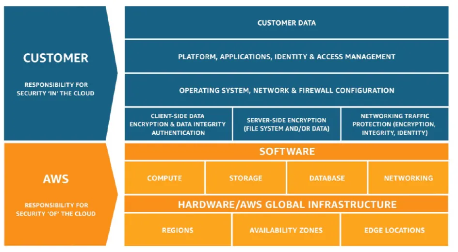

# AWS Shared Responsibility Model

- The shared responsibility model defines which security tasks are handled by AWS and which are handled by the customer. The exact split depends on the service and deployment model.
## Responsibility of Customer (Security in Cloud)
- Customer Data
- Platform, Applications, IAM
- OS, Network, Firewall Configuration
- Client Side Data Security
- Server Side Encryption
- Network Traffic Protection
- Identity, access policies, and credential protection
- Application configuration and vulnerability management

## Responsibility of AWS (Security of Cloud)
- Software
- Compute
- Storage
- Database
- Networking
- Hardware

Customers are always responsible for how they configure their resources and protect their data. AWS remains responsible for the security of the underlying cloud infrastructure.

